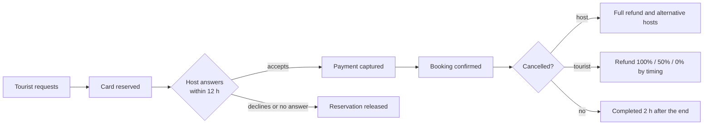

<div align="center">

# Ahla

**Book a local, not a tour.**

A web platform where visitors to Tunisia spend a few hours with verified local hosts: a medina walk, a family lunch, a pottery morning. Matched by language, interests and city, paid securely, in English, French and Arabic.

[](https://github.com/nourbouzir/Ahla/actions/workflows/ci.yml)


</div>

---

## Contents

[What is Ahla?](#what-is-ahla) · [Try it in 5 minutes](#try-it-in-5-minutes) · [Demo accounts](#demo-accounts) · [What you can do](#what-you-can-do) · [How a booking works](#how-a-booking-works) · [Everyday commands](#everyday-commands) · [Built with](#built-with) · [Project structure](#project-structure) · [Documentation](#documentation) · [Working together](#working-together)

## What is Ahla?

Tourists struggle to find a trustworthy local who speaks their language and shares their interests. Locals (students, artisans, fishermen, retirees) have no simple way to offer a few hours of their city or craft. Ahla connects them:

| If you are... | Ahla gives you... |
|---|---|
| **A tourist** | Search hosts by city, language, interests, price and rating. Every result explains **why this host** fits you. Book, pay and chat in your own language. |
| **A guide (host)** | A space to answer requests, see your day, track your clients, keep private notes, chat, and follow your earnings. |
| **An admin** | A dashboard for users, guides, applications, bookings, revenue and an audit log of every important change. |

Trust comes first: a host can only be found and booked after an admin has checked their identity document and had a short video call with them.

## Try it in 5 minutes

You need: **Git**, **PHP 8.3** (with `pdo_mysql`, `mbstring`, `intl`, `gd`, `bcmath`), **Composer 2**, **Node 20+** and **MySQL 8**. On Windows use **Git Bash**.

```bash
git clone https://github.com/nourbouzir/Ahla.git
cd Ahla

cp .env.example .env            # then open .env and set DB_DATABASE, DB_USERNAME, DB_PASSWORD
composer install
npm ci
php artisan key:generate

php artisan migrate --seed      # builds the database and fills it with demo data
php artisan storage:link
npm run build                   # compiles the design

php artisan serve               # open http://localhost:8000
```

Create an empty MySQL database first (the name you put in `DB_DATABASE`). Prefer not to install MySQL? The automated tests run on SQLite and need none: `composer test`.

> **Already cloned an older version?** Update it with `git pull`, `composer install`, `npm ci`, `npm run build`, then `php artisan migrate:fresh --seed`. The last command rebuilds the demo database from scratch.

## Demo accounts

Every demo account uses the password **`password`**. On the login page (development only) a panel lists them with a **Use** button that fills the form for you.

| Role | Email | Where you land |
|---|---|---|
| Admin | `admin@ahla.test` | `/admin`: the admin dashboard |
| Guide | `amel@ahla.test` | `/host/dashboard`: the guide dashboard |
| Guide with a pending request | `youssef@ahla.test` | accept or decline from the overview |
| Guide waiting for verification | `omar@ahla.test` | his application is in the admin queue: approve it from `admin@ahla.test` |
| Tourist | `tourist@ahla.test` | the home page |

A ten-minute guided tour of the main journey is in **[docs/demo.md](docs/demo.md)**.

## What you can do

**Tourists**
- Search and filter hosts; see a match score and the reasons behind it.
- Request a booking. Your card is only *reserved* until the host accepts; it is released if the host declines or stays silent for 12 hours.
- Chat with the host per booking. Messages are translated between English, French and Arabic, and you can always read the original.
- Get refunded in full if the host cancels, plus suggestions of other verified hosts in the same city when it happens late.

**Guides**
- Overview with requests to answer (live countdown), the next seven days, an earnings chart and a setup checklist.
- Clients with stages (awaiting, upcoming, returning, past), booking history and **private notes** no one else can read.
- One inbox for all booking chats, a monthly calendar with days off, and earnings net of refunds with CSV export.

**Admins**
- Platform overview with a "needs attention" list.
- Users: search, filter, lock an account (logged out at once, fully audited).
- Guides compared by rating, bookings, cancellation rate and volume; suspend or reinstate.
- Revenue: money paid, refunded and net volume per month, plus an *indicative* revenue figure ([ADR 0007](docs/decisions/0007-indicative-revenue-and-account-locking.md)).

## How a booking works



The rules that protect both sides live in one place (`BookingService`): a host never has overlapping confirmed bookings, never more than **two per day**, and a booking is only confirmed after the payment really succeeds. Parallel clicks are safe: the rules run under a database lock and are tested with real simultaneous processes.

## Everyday commands

| I want to... | Run |
|---|---|
| Start the app | `php artisan serve` |
| Run the queue (emails, translations) | `php artisan queue:work` |
| Run the scheduler (expiry, reconcile) | `php artisan schedule:work` |
| Run all tests (SQLite, no MySQL needed) | `composer test` |
| Check code style / fix it | `composer lint` / `composer lint:fix` |
| Reset demo data | `php artisan migrate:fresh --seed` |
| Watch front-end changes while coding | `npm run dev` |
| Load-test with 400 hosts | see [docs/performance.md](docs/performance.md) |

Not installed yet: payments run on a **sandbox gateway** (no real money moves) and translation needs a LibreTranslate-compatible service; without it the original text is shown. See [ADR 0005](docs/decisions/0005-payment-provider.md) and [ADR 0006](docs/decisions/0006-translation-provider.md).

## Built with

PHP 8.3 and **Laravel 12** (a modular monolith: nine self-contained modules under `app/Modules/`), **MySQL 8**, Blade templates with **Tailwind CSS 4** and a little plain JavaScript, bundled by **Vite**. Tests use PHPUnit; fonts (Inter, Noto Sans Arabic) are served from our own server.

## Project structure

<details>
<summary>Show the file tree (generated)</summary>

<!-- STRUCTURE:START (auto-generated by scripts/update-structure.sh — do not edit by hand) -->
```
.
.cursor
.cursor/rules
.cursorrules
.editorconfig
.env.example
.gitattributes
.githooks
.githooks/pre-push
.github
.github/CODEOWNERS
.github/ISSUE_TEMPLATE
.github/copilot-instructions.md
.github/pull_request_template.md
.github/workflows
.gitignore
.vscode
.vscode/extensions.json
.vscode/settings.sample.json
AI_CONTEXT.md
CLAUDE.md
CONTRIBUTING.md
LICENSE
README.md
app
app/Contracts
app/Events
app/Http
app/Jobs
app/Models
app/Modules
app/Providers
artisan
bootstrap
bootstrap/app.php
bootstrap/cache
bootstrap/providers.php
composer.json
composer.lock
config
config/ahla.php
config/app.php
config/auth.php
config/cache.php
config/database.php
config/filesystems.php
config/logging.php
config/mail.php
config/queue.php
config/services.php
config/session.php
database
database/.gitignore
database/factories
database/migrations
database/seeders
deploy
deploy/ahla-worker.conf
deploy/crontab
deploy/nginx.conf
docs
docs/CHANGELOG.md
docs/PROJECT_PLAN.md
docs/README.md
docs/architecture.md
docs/decisions
docs/demo.md
docs/deployment.md
docs/performance.md
docs/requirements
docs/runbook.md
docs/setup-report.md
docs/setup.md
docs/traceability.md
docs/usability-test.md
lang
lang/ar
lang/en
lang/fr
package-lock.json
package.json
phpunit.xml
public
public/.htaccess
public/favicon.ico
public/favicon.svg
public/images
public/index.php
public/robots.txt
resources
resources/css
resources/js
resources/views
routes
routes/api.php
routes/console.php
routes/web.php
scripts
scripts/backup.sh
scripts/check-docs.sh
scripts/deploy.sh
scripts/loadcheck.php
scripts/restore.sh
scripts/setup.sh
scripts/smoke-test.sh
scripts/update-structure.sh
storage
storage/app
storage/framework
storage/logs
tests
tests/Concerns
tests/Feature
tests/Fixtures
tests/TestCase.php
tests/Unit
tests/load
vite.config.js
```
<!-- STRUCTURE:END -->

</details>

Each module owns its routes, views, translations, migrations and seeder, so two people rarely edit the same file. How modules work: [docs/setup.md](docs/setup.md).

## Documentation

| Read this | To learn |
|---|---|
| [docs/demo.md](docs/demo.md) | A ten-minute tour, plus the guide and admin spaces |
| [docs/architecture.md](docs/architecture.md) | How the system is put together |
| [docs/decisions/](docs/decisions/) | Why we chose what we chose (7 ADRs) |
| [docs/traceability.md](docs/traceability.md) | Which test proves each requirement |
| [docs/deployment.md](docs/deployment.md) | Putting it on a server |
| [docs/runbook.md](docs/runbook.md) | Backups, restore, reliability |
| [docs/performance.md](docs/performance.md) | Measured speed and how to repeat it |
| [docs/usability-test.md](docs/usability-test.md) | Script for testing with real tourists |
| [docs/requirements/](docs/requirements/) | The SRS and SDD source documents |
| [CONTRIBUTING.md](CONTRIBUTING.md) | Branches, commits, pull requests |

## Working together

1. Never push to `main`. Create a branch: `git checkout -b feat/short-name`.
2. Commit small, with clear messages.
3. Open a pull request; the other person reviews it.
4. CI (tests, code style, MySQL concurrency tests) must be green before merging.

Full details in [CONTRIBUTING.md](CONTRIBUTING.md). Questions about a requirement? Check [docs/requirements/](docs/requirements/) and the ADRs before guessing.

**Team:** Salma Gzara ([@SalmaGz](https://github.com/SalmaGz)) and Nour Bouzir ([@nourbouzir](https://github.com/nourbouzir)) · CS 488, AI-First Software Engineering · [MIT License](LICENSE)
