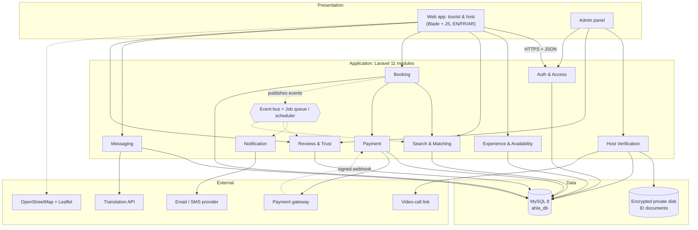
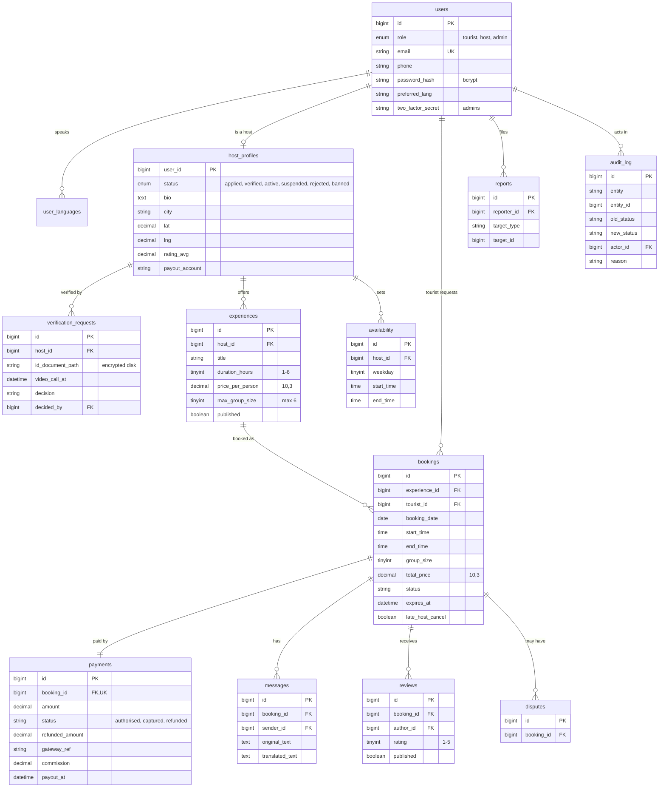
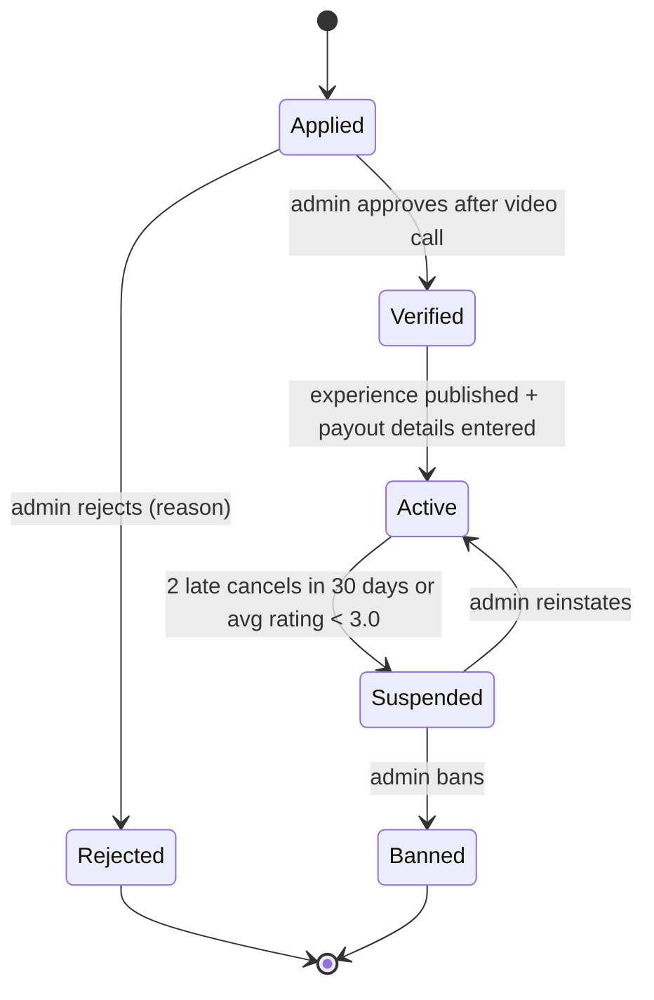
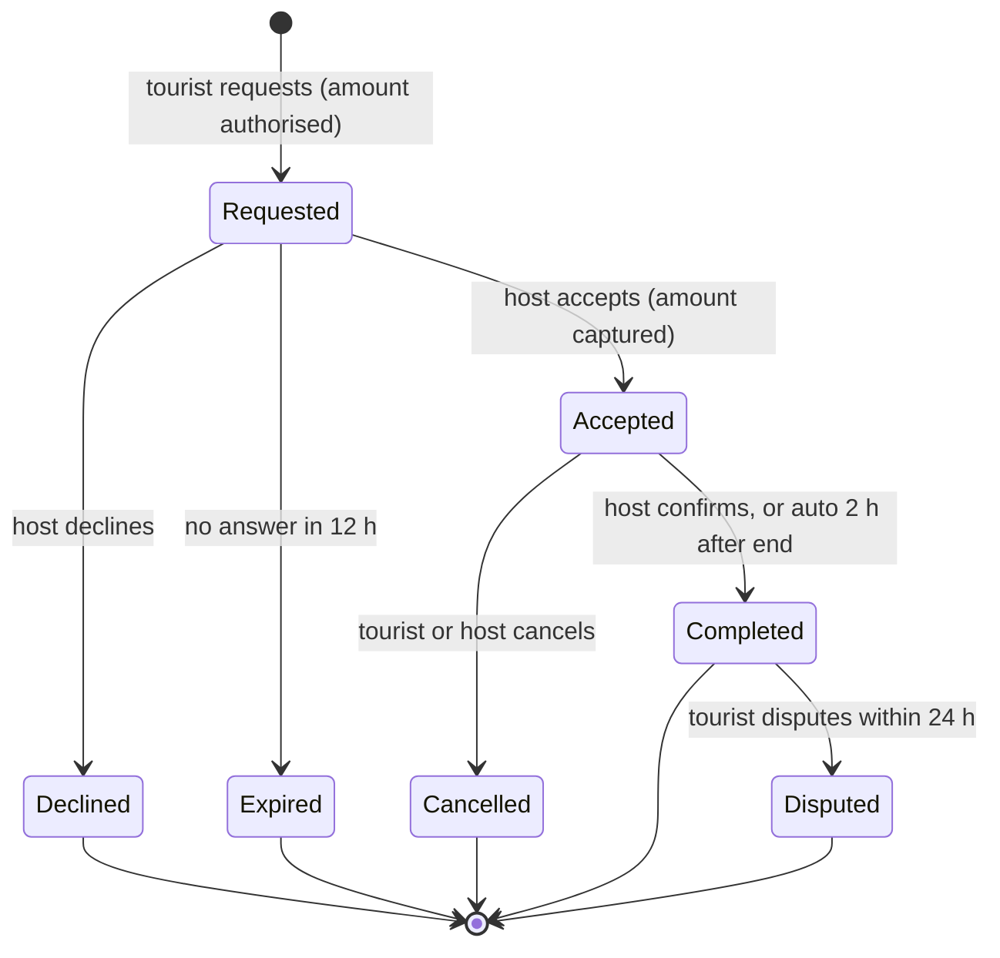
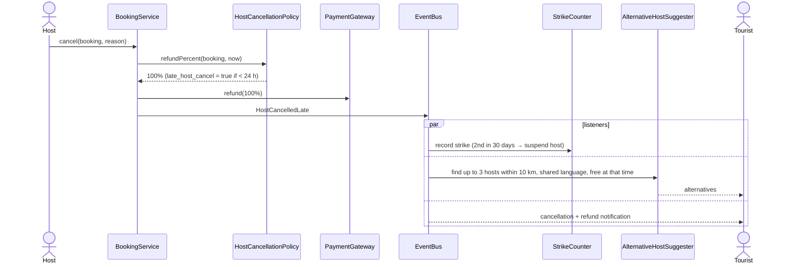

# Architecture

> Carried forward from the Software Design Description (`docs/requirements/Ahla_SDD.docx`,
> v1.0, IEEE 1016) and aligned with the current requirements baseline
> (`docs/requirements/Ahla_SRS_FV.docx`). Keep it a living document: when the real
> code drifts from this, update this file (or the code).
>
> Requirement IDs below (`FR-xx`, `NFR-xx`) follow the **SDD / SRS v1.0** numbering
> unless marked "FV". The two numbering schemes are different — see §7.

## 1. Overview

AHLA is a **layered modular monolith** built with Laravel 11 (PHP 8.3) and MySQL 8
(decision: [ADR 0002](decisions/0002-use-laravel-modular-monolith.md)).
Tourists and hosts use a mobile-first web app (Blade + plain JavaScript, English /
French / Arabic with right-to-left layout); admins use an admin panel. Both call
the Laravel application over HTTPS. Only the application touches the database and
the encrypted storage.

Requests flow downwards: **presentation → application (modules) → data**. A module
never reads another module's tables; it calls that module's *service* or reacts to
its *domain events*. Slow work (email/SMS, translation, alternative-host
suggestions) and every time-based rule (12 h request expiry, reminders,
auto-complete, payouts, ID-document purge) runs on a **job queue and scheduler**,
not inside the user's request.

Five external services sit behind interfaces: payment gateway, translation API,
map service (browser-side Leaflet/OpenStreetMap), email/SMS provider, and a
video-call link (e.g. Jitsi) used for host verification.

## 2. Component diagram



### Component responsibilities

| Component | Responsibility | Talks to |
|-----------|----------------|----------|
| Auth & Access | Registration, login, roles, 2FA for admins, 30-min session timeout | Users table, all controllers |
| Host Verification | Applications, ID storage, video-call scheduling, host state machine | Encrypted storage, Notification, video-call link |
| Experience & Availability | Experiences, weekly slots, blocked dates, meeting points | Map service, DB |
| Search & Matching | Filters and ranks hosts with strategies; finds alternative hosts | Experience module, DB |
| Booking | Requests, daily-limit and overlap checks, accept/decline, cancel, complete, booking state machine | Payment, Matching, Event bus |
| Payment | Authorise, capture, refund (refund policies), payouts minus commission | Payment gateway (Adapter), DB |
| Messaging | Booking conversations, contact masking, translation | Translation service (Adapter) |
| Reviews & Trust | Reviews, ratings, reports, strike counter, automatic suspension, disputes | Booking, Verification |
| Notification | Email / SMS / in-app messages for every event and reminder | Email/SMS provider, Event bus |
| Event bus + queue | Dispatches domain events to listeners; runs timed jobs | All modules |

### Scheduled jobs

| Job | Frequency | What it does |
|-----|-----------|--------------|
| `ExpireRequests` | Every 10 min | Requests older than 12 h → Expired; release authorisation; notify tourist |
| `SendReminders` | Every 10 min | Reminders 24 h and 2 h before each accepted booking |
| `AutoComplete` | Every 30 min | Bookings ended 2 h ago with no dispute → Completed |
| `ReleasePayouts` | Hourly | Completed > 24 h ago, no dispute → payout (amount − 15%) |
| `PublishReviews` | Daily | Publish reviews older than 14 days |
| `PurgeIdDocuments` | Daily | Delete ID files 90 days after the verification decision |

## 3. Key modules

| Module | Responsibility | Lives in |
|--------|----------------|----------|
| Auth | Accounts, roles, sessions, 2FA | `app/Modules/Auth/` |
| Verification | Host applications, ID, video call, `HostState` | `app/Modules/Verification/` |
| Experience | Experiences, availability, meeting points | `app/Modules/Experience/` |
| Matching | `MatchingService`, `MatchingStrategy` implementations | `app/Modules/Matching/` |
| Booking | `BookingService`, `Booking`, `BookingState` | `app/Modules/Booking/` |
| Payment | `PaymentGateway` adapters, `RefundPolicy` classes, payouts | `app/Modules/Payment/` |
| Messaging | Messages, `Translator` adapter | `app/Modules/Messaging/` |
| Trust | Reviews, reports, disputes, `StrikeCounter` | `app/Modules/Trust/` |
| Notification | `NotificationListener`, channels | `app/Modules/Notification/` |
| Events / Jobs | Domain events, listeners, scheduled jobs | `app/Events/`, `app/Listeners/`, `app/Jobs/` |

### Design patterns (SDD §8)

| Pattern | Applied to |
|---------|------------|
| **State** | `HostState` (Applied, Verified, Active, Suspended, Rejected, Banned) and `BookingState` (Requested, Accepted, Declined, Expired, Cancelled, Completed, Disputed) — each state class allows or refuses each action |
| **Strategy** | `MatchingStrategy` (Language, Interest, Proximity, Rating) combined by `MatchingService` with configurable weights; `RefundPolicy` (`TouristCancellationPolicy`, `HostCancellationPolicy`) |
| **Observer** (domain events) | `EventBus` with `NotificationListener`, `StrikeCounter`, `AlternativeHostSuggester`, `AuditLogger`; slow listeners run on the queue |
| **Adapter** | `PaymentGateway` (one adapter per provider) and `Translator` (provider adapter + fallback returning the original text) |

## 4. Data model

Money is `DECIMAL(10,3)` (TND has 3 decimals), never a float. Every host, booking
and payment status change is written to `audit_log`.



Integrity rules:

- The daily limit is enforced by locking the host's bookings for that date (`SELECT … FOR UPDATE`) *before* counting, inside the same transaction that inserts or accepts the booking.
- A booking's `payments` row is created in the same transaction as the booking; a failed authorisation rolls everything back.
- `bookings` has `INDEX(experience_id, booking_date)` and `INDEX(status, expires_at)`; `reviews` has `UNIQUE(booking_id, author_id)`.
- ID documents live on an encrypted private disk and are deleted by `PurgeIdDocuments` 90 days after the decision.

### State machines





## 5. Key flows

### 5.1 Request a booking and the host accepts (UC-06, UC-07)

```mermaid
sequenceDiagram
    actor T as Tourist
    participant API as BookingController
    participant BS as BookingService
    participant DB as MySQL
    participant PG as PaymentGateway
    participant BUS as EventBus
    actor H as Host

    T->>API: POST /api/bookings
    API->>BS: request(experience, date, start, group)
    BS->>DB: BEGIN; lock host's bookings for the date
    BS->>BS: host Active? <2 accepted? no overlap? group fits?
    alt rule violated
        BS-->>T: 409 host full / slot taken (reason)
    else rules pass
        BS->>PG: authorise(total)
        alt card refused
            PG-->>BS: refused
            BS->>DB: ROLLBACK
            BS-->>T: 402 payment could not be authorised
        else authorised
            BS->>DB: INSERT booking (Requested, expires in 12 h) + payment; COMMIT
            BS->>BUS: BookingRequested
            BUS-->>H: SMS + email (queued)
            BS-->>T: 201 booking requested
        end
    end
    H->>API: POST /api/bookings/{id}/accept
    API->>BS: accept(booking)
    BS->>DB: BEGIN; lock date; re-count accepted bookings
    BS->>PG: capture(amount)
    BS->>DB: status = Accepted; COMMIT
    BS->>BUS: BookingAccepted
    BUS-->>T: notification, phone number revealed
```

### 5.2 Host cancels less than 24 hours before (UC-08)



## 6. The AI-assisted component

**What it is.** Host recommendation (FR-09, FR-10 in SRS FV): given a tourist's
preferences, return an ordered list of eligible hosts, each with a human-readable
reason tied to an input preference or host attribute.

**How it works today (design, not yet built).** `MatchingService.search()`:

1. Filter: only bookable hosts with a free slot on the date, a group size that fits, and at least one language in common with the tourist.
2. Score = `0.4 × language + 0.3 × interests + 0.2 × proximity + 0.1 × rating`, where language = 1 if the host speaks the tourist's preferred language (else 0.5), interests = shared ÷ tourist's interests, proximity = `1 − distance ÷ 15 km`, rating = average ÷ 5 (new hosts count as 4.0 so they are not hidden).
3. The two strongest criteria become the "why this host" tags (e.g. "speaks French · loves food"). Weights live in configuration.

**What goes in / out.** In: tourist preferences (city, date, language, interests, group size, location) and host profile data. Out: ranked hosts + `whyMatched` tags (`GET /api/search`). No card data and no ID documents are ever used.

**Translation** (FR-19 in SRS FV) is a separate external service behind the `Translator` interface.

**If it fails.** Scoring is local and deterministic, so there is no external dependency to fail. If translation is unavailable, the original text is shown with a "translation unavailable" note (NFR-11). If an LLM is added later it must be optional and fall back to this scoring — that would need its own ADR.

## 7. Known trade-offs / open questions

**Document mismatches (SDD vs current SRS FV).** The SDD was written against SRS v1.0; SRS FV states that the previous 15 FR / 12 NFR set is superseded.

| Topic | SDD (this file) | SRS FV |
|-------|-----------------|--------|
| IDs | FR-01…FR-26 | FR-01…FR-25 (different meaning) |
| Host states | applied / verified / active / suspended / rejected / banned | Pending / Verified / Rejected / Suspended |
| Platform | Web only | Android, iOS and web (NFR-16) |
| Payment | Authorise → capture on accept ([ADR 0003](decisions/0003-authorise-then-capture-with-locked-transactions.md)) | Confirm only after successful payment (FR-15) |
| Alternatives | ≤ 3 hosts within 10 km | An available host in the same city (FR-17) |
| Commission, strikes, disputes, payouts, reviews | Specified | Not specified / Candidate |

**Open issues carried over from the SDD**

- Choose the payment provider (authorise/capture/refund, international cards, payouts in TND) — decide in sprint 1.
- Confirm matching weights with real users after the first usability test.
- Whether a booking can span midnight (currently not allowed: experiences end the same day).

**Open issues from SRS FV (§19)** — message-eligibility rule (FR-18), notification scope (FR-20), password-reset/session/role policies, calendar time zone and overlap boundaries, RPO/RTO for backups, load profile for "thousands" of concurrent users, and approval of Candidate features FR-21 to FR-25.

**Trade-offs accepted.** The monolith scales as one unit, so translation is isolated on the queue. Microservices and a message broker were rejected as too heavy for a student team and risky for money and limits.
