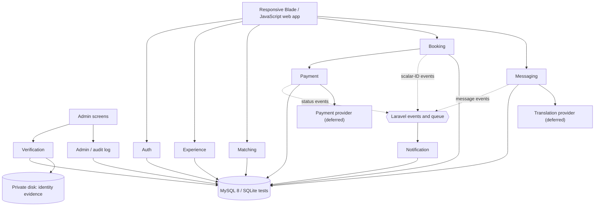
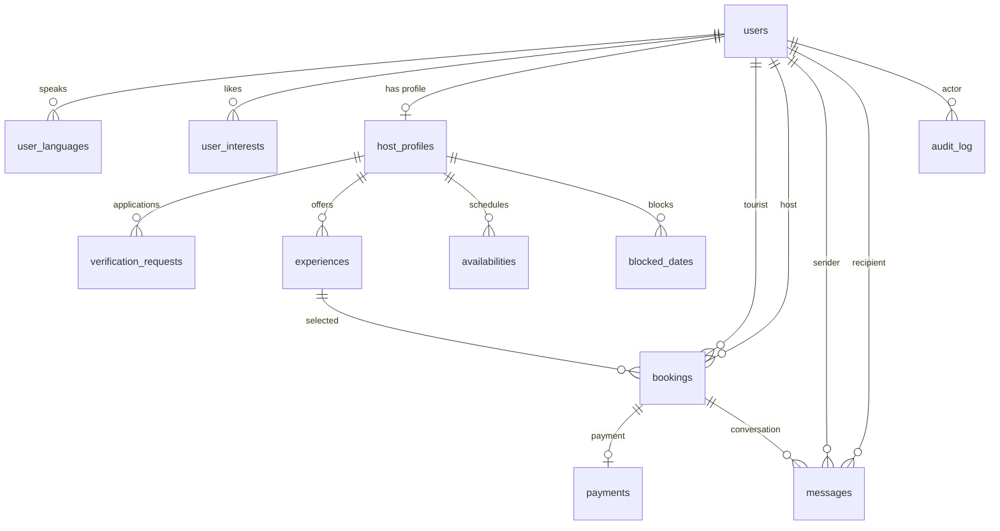

# Architecture

The requirements baseline is [`Ahla_SRS_FV.docx`](requirements/Ahla_SRS_FV.docx);
the older SDD is used only where ADR 0004 retains a design needed by an FV
requirement. Cite SRS FV IDs only. See [ADR 0004](decisions/0004-reconcile-srs-fv-and-sdd.md)
and the [requirement ID mapping](requirements/ID-mapping.md).

## 1. Overview

Ahla is a Laravel 12 modular monolith (PHP 8.3), with MySQL 8 for deployment
and in-memory SQLite for tests. The web app is responsive and mobile-first:
travellers discover verified Tunisian hosts, explore experiences, and book
through them. The current first slice is a social-discovery demo with mock
connections/chat and a database-backed experience catalogue; its social state
is browser-persisted and is not a backend implementation.

Feature routes, views, migrations, language files, and seeders live in
`app/Modules/<Module>/`. Modules communicate through services, contracts in
`app/Contracts/`, and scalar-ID events in `app/Events/`. Events carry IDs and
primitive status values, never Eloquent model payloads. Queue/scheduler behavior
is added with its implementation issues; this foundation does not claim that
booking, notification, or expiry workflows are already operational.

## 2. Components and boundaries

| Module | Owns |
|--------|------|
| Auth | User roles, preferred language, languages, interests, and accounts |
| Verification | Host profile, identity evidence metadata, call, and decision |
| Experience | Experiences, recurring availability, and blocked dates |
| Matching | Verified-host discovery and recommendation explanations |
| Booking | Booking records, lifecycle rules, and status enum |
| Payment | Payment records, gateway contract, and payment status enum |
| Messaging | Booking messages and translation contract |
| Notification | Laravel database notifications |
| Admin | Audit log and administrative records |

`AppServiceProvider` binds each contract using `config/ahla.php`. Local/test
defaults are fakes; production fails fast if a binding is missing or does not
implement its contract. The payment provider remains unselected (ADR 0005 /
issue #11).

## 3. Cross-module contracts

| Contract | Phase 0 fake behavior |
|----------|----------------------|
| `PaymentGateway` | Idempotent authorise/capture/refund; configurable success, decline, and timeout; exposes current status |
| `Translator` | Configurable translation map; passes the original text through when no entry exists |
| `HostEligibility::isBookable(hostId)` | Configurable eligibility result; defaults to ineligible |
| `AvailabilityChecker::isSlotAvailable(hostId, date, start, end)` | Configurable result; defaults to unavailable |
| `AlternativeHostFinder::find(booking)` | Configurable host-user IDs; defaults to no alternatives |

Domain events include booking requested/confirmed/cancelled/status changed,
payment status changed, host status changed, message sent, and refund requested.
Payloads use scalar identifiers, status strings, amounts, and reasons. These events establish the
handoff shape; queued listeners and real domain workflows are later-phase work.

## 4. Data model

Money uses `DECIMAL(10,3)` in TND. Never store card data. The Phase 0 migrations
add to the existing Laravel users table and are ordered so identity/catalog
tables exist before the booking/payment/message schema.

| Table | Important fields and rules |
|-------|-----------------------------|
| `users` | `role` (`tourist`, `host`, `admin`), `phone`, `preferred_language` |
| `user_languages`, `user_interests` | Normalized values unique per user; language is indexed |
| `host_profiles` | User FK, `pending/verified/rejected/suspended`, display name, bio, city, coordinates, public photo URL, nullable rating average; city/status indexed |
| `verification_requests` | Host-profile FK, private evidence path, call link/time, submitted/scheduled/decided status, decision/reason, deciding admin |
| `experiences` | Host-profile FK, title/category/interest tags/description, duration, meeting point, per-person TND price, group limit, publish flag |
| `availabilities`, `blocked_dates` | Recurring weekday time slots and unique host/date blocks |
| `bookings` | Tourist/host user FKs, experience FK, local `date/start_time/end_time`, group size, `location`, `displayed_price` snapshot, status, expiry and cancellation details |
| `payments` | One per booking, TND `amount/refunded_amount`, optional `gateway_ref`, status and lifecycle timestamps |
| `messages` | Booking, sender and recipient FKs; `original_text`, `translated_text`, `language`, translation language, read timestamp |
| `notifications` | Laravel UUID notification with polymorphic recipient and JSON data |
| `audit_log` | Entity/ID, old/new status, actor, reason, timestamp; generic entity ID is not a foreign key |

There are no reviews, disputes, reports, payout, commission, strike, or reminder
tables/jobs in v1. `rating_avg` is nullable until review policy is resolved;
unrated hosts use the 4.0 matching default and are excluded only when a minimum
rating filter is explicitly selected.

## 5. Persisted state vocabulary and business rules

Host states: `pending`, `verified`, `rejected`, `suspended`. Only verified
hosts are eligible for search and booking. Booking states:
`requested`, `confirmed`, `declined`, `expired`, `cancelled`, `completed`.
Payment states: `authorised`, `captured`, `released`, `refunded`, `failed`.

The payment sequence is authorise on request, capture on host acceptance, and
release on decline/expiry. A booking is confirmed only after successful capture.
If the selected provider cannot separate authorisation and capture, charge on
request and refund on decline/expiry. Request TTL is 12 hours.

The daily limit and overlap check count confirmed bookings only and must be
rechecked inside the locked transaction on host acceptance (NFR-14). Times use
`Africa/Tunis`; intervals are half-open `[start, end)`, and bookings cannot cross
midnight. Host cancellation refunds 100%; the configurable interim tourist
policy is 100% at least 48 hours before, 50% 24–48 hours before, and 0% under
24 hours. Every host, booking, or payment status transition must write
`audit_log`.

For host cancellation under 24 hours, the alternative-host policy is up to three
verified, available hosts in the same city, excluding the cancelling host.
Language affects ranking but is not a filter; an empty result is valid.

These are accepted design decisions with remaining policy questions tracked in
ADR 0004. Booking/host state transition services, locked transactions, expiry
jobs, and operational status auditing are not implemented by the Phase 0
schema/contracts alone.

## 6. Recommendation and prototype boundary

The decision for FR-09/FR-10 is a deterministic score:

`0.4 × language + 0.3 × interests + 0.2 × proximity + 0.1 × rating`

Proximity is `1 - distance / 15 km` when both sides have coordinates, otherwise
1 for the same city and 0 for a different city. Unrated hosts score as 4.0.
Every result needs a human-readable reason. Whether this qualifies as
“AI-generated” is deferred to issue #24, owned by Nour with the instructor.

The existing demo's `MatchingService` currently ranks database-backed
experiences and explains city/language/interest matches; traveller coordinates,
the final proximity strategy, and production recommendation workflows remain
future work. The separate social connect/chat state in the demo is mock data,
not the Candidate like/pass or mutual-match backend (FR-21).

## 7. Decisions and deferred items

- [ADR 0002](decisions/0002-use-laravel-modular-monolith.md): Laravel 12 modular monolith.
- [ADR 0003](decisions/0003-authorise-then-capture-with-locked-transactions.md) as refined by [ADR 0004](decisions/0004-reconcile-srs-fv-and-sdd.md): payment and booking states.
- [ADR 0004](decisions/0004-reconcile-srs-fv-and-sdd.md): SRS/SDD reconciliation, interim defaults, deferred questions and owners.
- [`docs/requirements/ID-mapping.md`](requirements/ID-mapping.md): old-to-current requirement identifiers.

The payment provider (#11), tourist refund final policy (#13), ID retention/legal
basis (#15), source of ratings (#23), AI acceptance (#24), admin MFA (#35),
backup RPO/RTO (#39), load profile (#38), and SDD reissue are explicitly deferred
with owners in ADR 0004. Candidate FR-21 to FR-25 remain parked.
