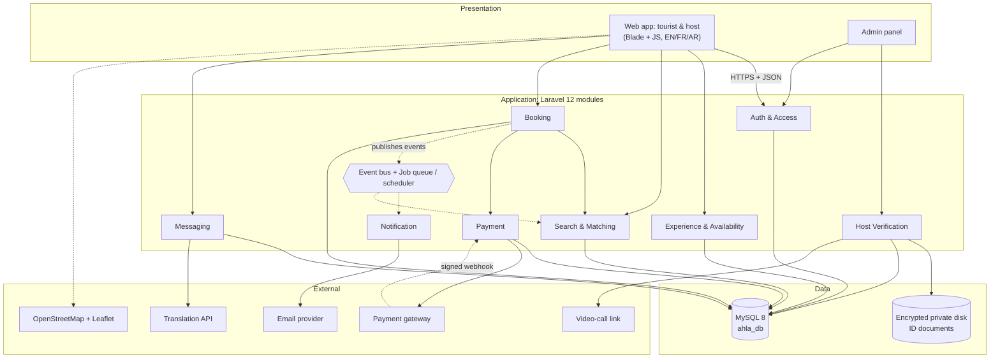
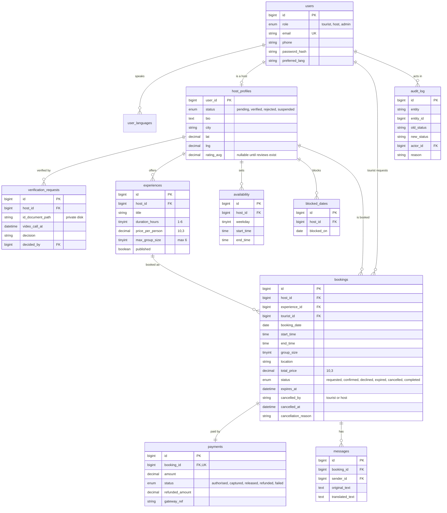
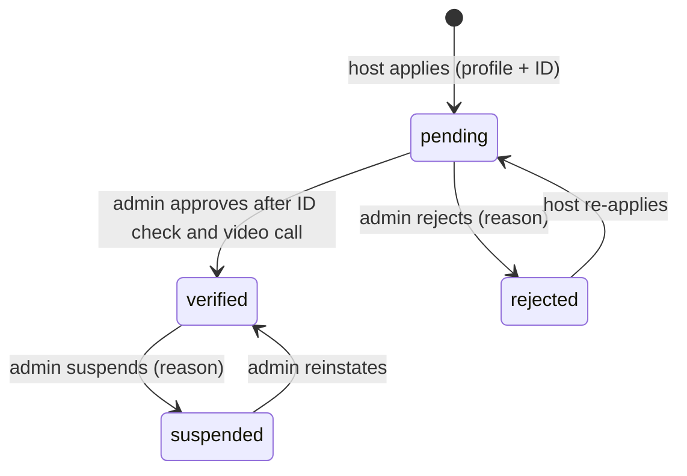
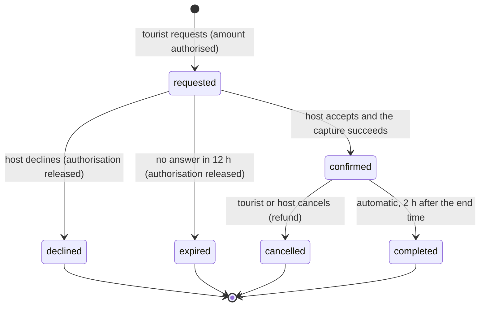
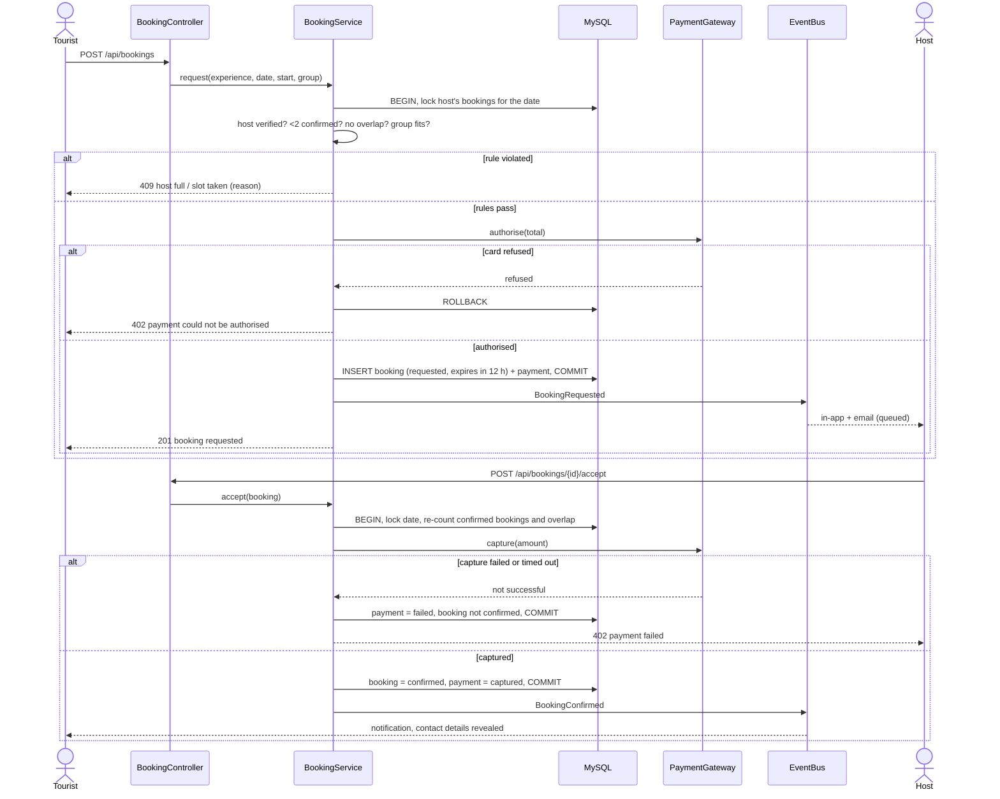
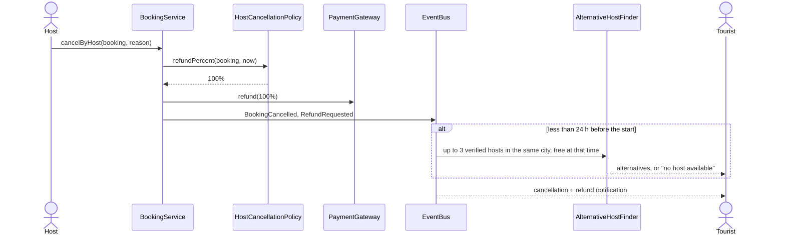

# Architecture

> Carried forward from the Software Design Description (`docs/requirements/Ahla_SDD.docx`,
> v1.0, IEEE 1016) and aligned with the current requirements baseline
> (`docs/requirements/Ahla_SRS_FV.docx`). Keep it a living document: when the real
> code drifts from this, update this file (or the code).
>
> Requirement IDs below (`FR-xx`, `NFR-xx`, `BR-xx`) are **SRS FV** ids. Where the SDD and
> SRS FV disagreed, [ADR 0004](decisions/0004-reconcile-srs-fv-and-sdd.md) decides and
> [`requirements/ID-mapping.md`](requirements/ID-mapping.md) maps the old ids.

## 1. Overview

AHLA is a **layered modular monolith** built with Laravel 12 (PHP 8.3) and MySQL 8
(decision: [ADR 0002](decisions/0002-use-laravel-modular-monolith.md)).
Tourists and hosts use a mobile-first web app (Blade + plain JavaScript, English /
French / Arabic with right-to-left layout); admins use an admin panel. Both call
the Laravel application over HTTPS. Only the application touches the database and
the encrypted storage.

Requests flow downwards: **presentation → application (modules) → data**. A module
never reads another module's tables; it calls that module's *service* or reacts to
its *domain events*. Slow work (email, translation, alternative-host
suggestions) and every time-based rule (12 h request expiry, auto-complete,
ID-document purge) runs on a **job queue and scheduler**,
not inside the user's request.

Five external services sit behind interfaces: payment gateway, translation API,
map service (browser-side Leaflet/OpenStreetMap), email provider, and a
video-call link (e.g. Jitsi) used for host verification.

### Implemented first slice

The current application entry point is the Matching module's mobile-first
social discovery demo (`GET /`): mock Tunisian locals can be explored, connected
with, and messaged in a browser-persisted prototype, alongside an editable
traveller profile and suggested experiences. The interactive Tunisia map uses
the public-domain Natural Earth 1:50m country boundary and city coordinates,
including the country's offshore islands. Its experience listings read published experiences for verified hosts,
supports city, language, interest, minimum-rating, maximum-price and text
filters, and ranks the results with the documented language / interest /
proximity / rating weights. Each result includes a short match explanation.
`GET /api/experiences` exposes the same search and ranking behavior as JSON.
The connection and conversation interactions are mock demo state; the host-profile and experience schemas and starter data are owned by their
Verification and Experience modules; user-facing discovery copy is translated
in English, French and Arabic.

## 2. Component diagram

### Component responsibilities

| Component | Responsibility | Talks to |
|-----------|----------------|----------|
| Auth & Access | Registration, login, password reset, roles, 30-min session timeout | Users table, all controllers |
| Host Verification | Applications, ID storage, video-call scheduling, host state machine | Encrypted storage, Notification, video-call link |
| Experience & Availability | Experiences, weekly slots, blocked dates, meeting points | Map service, DB |
| Search & Matching | Filters and ranks hosts with strategies; finds alternative hosts | Experience module, DB |
| Booking | Requests, daily-limit and overlap checks, accept/decline, cancel, complete, booking state machine | Payment, Matching, Event bus |
| Payment | Authorise, capture, release, refund (refund policies) | Payment gateway (Adapter), DB |
| Messaging | Booking conversations, contact masking, translation | Translation service (Adapter) |
| Notification | In-app and email messages for the in-scope events (ADR 0004, decision 10) | Email provider, Event bus |
| Event bus + queue | Dispatches domain events to listeners; runs timed jobs | All modules |

### Scheduled jobs

| Job | Frequency | What it does |
|-----|-----------|--------------|
| `ExpireRequests` | Every 10 min | `requested` bookings older than 12 h → `expired`; release the authorisation; notify the tourist |
| `AutoComplete` | Every 30 min | `confirmed` bookings that ended 2 h ago → `completed` |
| `PurgeIdDocuments` | Daily | Delete ID files 90 days after the verification decision |

Reminders, payouts and review publication are out of v1 ([ADR 0004](decisions/0004-reconcile-srs-fv-and-sdd.md), decision 12).

## 3. Key modules

| Module | Responsibility | Lives in |
|--------|----------------|----------|
| Auth | Accounts, roles, sessions | `app/Modules/Auth/` |
| Verification | Host applications, ID, video call, `HostState` | `app/Modules/Verification/` |
| Experience | Experiences, availability, meeting points | `app/Modules/Experience/` |
| Matching | `MatchingService`, `MatchingStrategy` implementations | `app/Modules/Matching/` |
| Booking | `BookingService`, `Booking`, `BookingState` | `app/Modules/Booking/` |
| Payment | `PaymentGateway` adapters, `RefundPolicy` classes | `app/Modules/Payment/` |
| Messaging | Messages, `Translator` adapter | `app/Modules/Messaging/` |
| Notification | `NotificationListener`, channels | `app/Modules/Notification/` |
| Events / Jobs | Domain events, listeners, scheduled jobs | `app/Events/`, `app/Listeners/`, `app/Jobs/` |

### Design patterns (SDD §8)

| Pattern | Applied to |
|---------|------------|
| **State** | `HostState` (pending, verified, rejected, suspended) and `BookingState` (requested, confirmed, declined, expired, cancelled, completed) — each state class allows or refuses each action |
| **Strategy** | `MatchingStrategy` (Language, Interest, Proximity, Rating) combined by `MatchingService` with configurable weights; `RefundPolicy` (`TouristCancellationPolicy`, `HostCancellationPolicy`) |
| **Observer** (domain events) | `EventBus` with `NotificationListener` and `AuditLogger`; the alternative-host lookup (`AlternativeHostFinder`) runs on a late host cancellation; slow listeners run on the queue |
| **Adapter** | `PaymentGateway` (one adapter per provider) and `Translator` (provider adapter + fallback returning the original text) |

## 4. Data model

Money is `DECIMAL(10,3)` (TND has 3 decimals), never a float. Every host, booking
and payment status change is written to `audit_log`.

Integrity rules:

- The daily limit and the overlap check are enforced by locking the host's bookings for that date (`SELECT … FOR UPDATE`) *before* counting, inside the same transaction that inserts or confirms the booking. Only `confirmed` bookings count. Intervals are half-open `[start, end)`, so a booking may start exactly when another ends, and times are in Africa/Tunis (ADR 0004, decision 11).
- A booking's `payments` row is created in the same transaction as the booking; a failed authorisation rolls everything back.
- `bookings` has `INDEX(host_id, booking_date)` (locking and overlap) and `INDEX(status, expires_at)` (expiry job).
- ID documents live on the private disk and are deleted by `PurgeIdDocuments` 90 days after the decision.
- Not in v1: reviews, disputes, reports, and commission or payout columns ([ADR 0004](decisions/0004-reconcile-srs-fv-and-sdd.md), decision 12).

### State machines

## 5. Key flows

### 5.1 Request a booking and the host accepts (UC-06, UC-07)

### 5.2 Host cancels a confirmed booking (UC-08)

A host cancellation always refunds 100%. Less than 24 hours before the start, the tourist
also gets alternative hosts.

## 6. The AI-assisted component

**What it is.** Host recommendation (FR-09, FR-10 in SRS FV): given a tourist's
preferences, return an ordered list of eligible hosts, each with a human-readable
reason tied to an input preference or host attribute.

**How it works today (design, not yet built).** `MatchingService.search()`:

1. Filter: only `verified` hosts with a free slot on the date and a group size that fits. A shared language is a ranking factor, not a filter.
2. Score = `0.4 × language + 0.3 × interests + 0.2 × proximity + 0.1 × rating`, where language = 1 if the host speaks the tourist's preferred language (else 0.5), interests = shared ÷ tourist's interests, proximity = `1 − distance ÷ 15 km` when both sides have coordinates, otherwise 1 for the same city and 0 for another city, rating = average ÷ 5 (unrated hosts count as 4.0 so they are not hidden).
3. The two strongest criteria become the "why this host" tags (e.g. "speaks French · loves food"). Weights live in configuration.

**What goes in / out.** In: tourist preferences (city, date, language, interests, group size, location) and host profile data. Out: ranked hosts + `whyMatched` tags (`GET /api/search`). No card data and no ID documents are ever used.

**Translation** (FR-19 in SRS FV) is a separate external service behind the `Translator` interface.

**If it fails.** Scoring is local and deterministic, so there is no external dependency to fail. If translation is unavailable, the original text is shown with a "translation unavailable" note (NFR-11). If an LLM is added later it must be optional and fall back to this scoring — that would need its own ADR.

## 7. Known trade-offs / open questions

**The SDD and SRS FV are reconciled.** The SDD was written against the first SRS, and SRS FV supersedes it.
[ADR 0004](decisions/0004-reconcile-srs-fv-and-sdd.md) records every decision (host states, payment flow, booking
states, request expiry, refunds, alternative hosts, platform, messaging, notifications, time zone, and what is out
of v1), and [`requirements/ID-mapping.md`](requirements/ID-mapping.md) maps the old ids. The design above already
reflects those decisions.

**Still open** (owners and the default used meanwhile are in ADR 0004): tourist refund percentages; where ratings
come from before reviews exist; whether a rule-based score counts as "AI-generated"; ID-evidence retention and legal
basis; admin two-factor authentication; the payment provider ([ADR 0005](decisions/) once written); backup RPO and RTO
and the load profile for "thousands" of users; whether to reissue the SDD as v1.1. Matching weights should also be
confirmed with real users after the first usability test.

**Trade-offs accepted.** The monolith scales as one unit, so translation is isolated on the queue. Microservices and a
message broker were rejected as too heavy for a student team and risky for money and limits.
## Role / action matrix (issue #9)

One list in `app/Modules/Auth/Support/Permissions.php` feeds a Gate ability per row. Controllers use `can:<ability>` or `role:<role>`; nobody compares roles by hand. Guests can only browse and search.

| Ability | Tourist | Host | Admin |
|---------|:-------:|:----:|:-----:|
| profile.edit, booking.view | yes | yes | yes |
| booking.request | yes | - | - |
| booking.respond, host.apply, experience.manage, availability.manage | - | yes | - |
| booking.cancel, message.send | yes | yes | - |
| admin.verifications, admin.host-status, admin.audit | - | - | yes |

Phone and email of the other party are shown only after a booking is `confirmed` (owner and admin always see their own / any). A tourist profile is private to its owner, admins and hosts they have a booking with; a host profile is public once the host is `verified`.

## Payment engine (issues #11-#14)

`PaymentService` is the only code that calls `PaymentGateway` and the only writer of `payments.status`. Steps: `authorise` (on request) -> `capture` (host accepts) | `release` (declined or expired) | `refund` (after cancellation). Each step uses an idempotency key, writes `audit_log` and fires `PaymentStatusChanged`. `RefundService` picks a `RefundPolicy` (`HostCancellationRefundPolicy` always 100%; `TouristCancellationRefundPolicy` 100% / 50% / 0% from `config/ahla.php`), and amounts are bcmath strings. `POST /api/payments/webhook` accepts forward-only status changes signed with HMAC-SHA256.

## Hosts and booking engine (Phase 2, issues #15-#22)

- **Host state** (`Verification/States`): `pending -> verified | rejected`, `verified -> suspended`, `suspended -> verified | rejected`, `rejected -> pending` (re-apply). `HostStatusService` is the only writer of `host_profiles.status`; a reason is required to reject or suspend; every change is audited. `VerifiedHostEligibility` implements `HostEligibility`: only `verified` is bookable.
- **Verification**: the host uploads an ID image or PDF (max 5 MB). The file is encrypted (`Crypt`) before it is written to the private disk and only an admin download decrypts it. An admin schedules a video call, then approves (needs a scheduled call) or rejects (needs a reason).
- **Availability**: weekly hours plus blocked dates; `WeeklyAvailabilityChecker` implements `AvailabilityChecker`. It does not look at other bookings.
- **Booking** (`BookingService`, the only place with these rules): request -> authorise payment -> host accepts -> capture -> `confirmed`. A failed or timed-out authorise rolls the booking back; a failed capture leaves it `requested`. Overlap uses half-open `[start, end)` among **confirmed** bookings; at most 2 confirmed per host per day; no booking crosses midnight; requests expire after 12 h. Request, accept and cancel start by locking the host's user row (`SELECT ... FOR UPDATE`), then re-count. `BookingConcurrencyTest` runs parallel `php artisan booking:accept` processes on MySQL and fails if the lock is removed (checked); CI runs it against a MySQL service.
